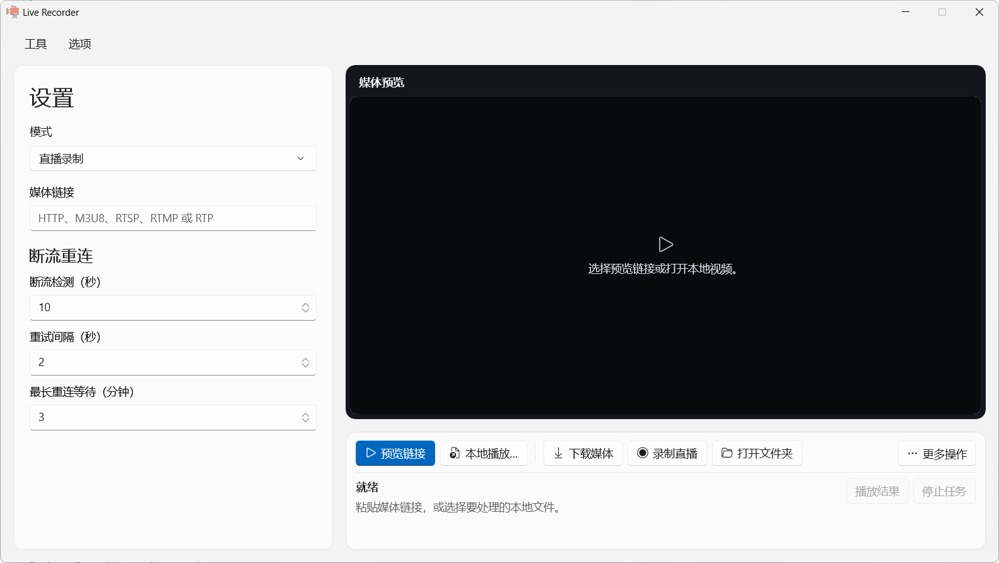
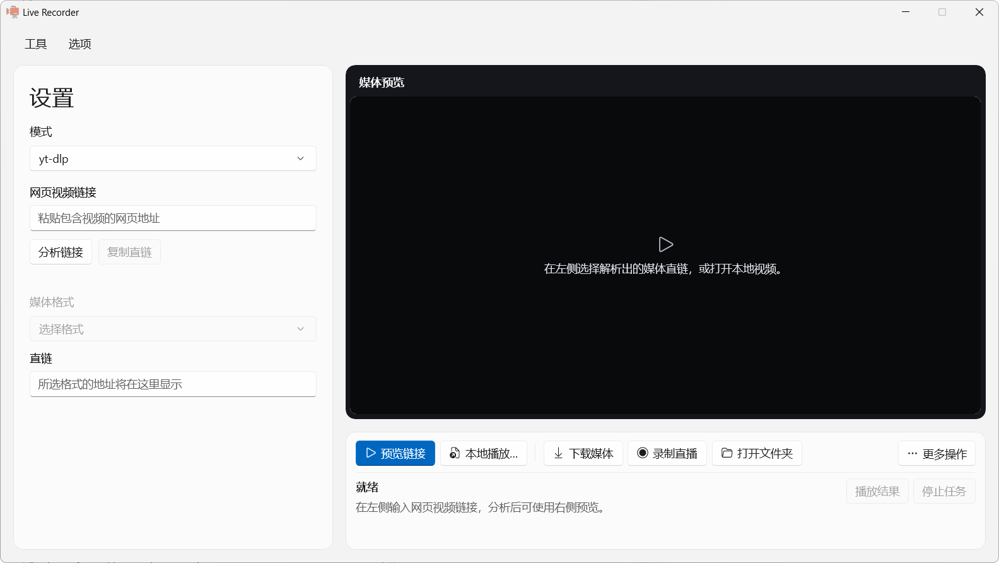
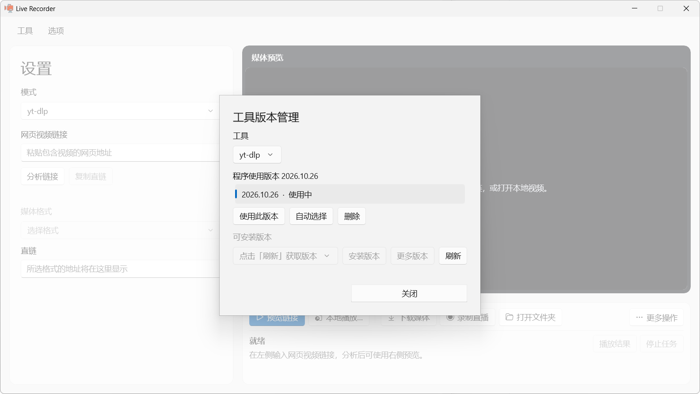
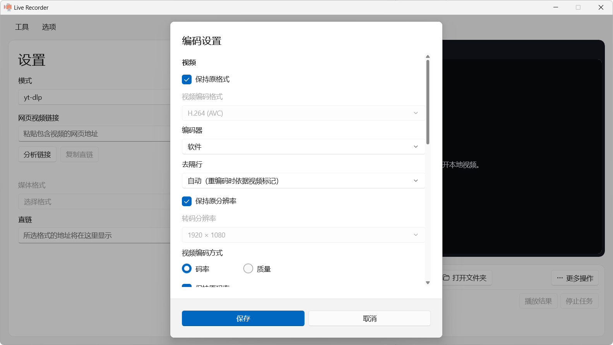

# Live Recorder

Live Recorder 是使用 C#、WinUI 3 和 Windows App SDK 构建的 Windows 媒体下载和录制工具。提供「直播录制」和「yt-dlp」两种模式，支持 Windows 10 2004（19041）及以上版本和 Windows 11 的 x64 系统。






## 运行发布版

完整解压发布包到可写目录后，双击 `LiveRecorder.exe`。首次使用录制、转码等功能时，从「工具」菜单安装 FFmpeg。使用 yt-dlp 模式前，从同一菜单安装 yt-dlp，程序会一并安装网页分析所需的 Deno。

## 直播录制

左侧「模式」默认选择「直播录制」。在「媒体链接」中粘贴直链，再通过右侧工具栏操作。

- 点击「预览链接」播放当前链接。也可以打开本地视频，或播放最近一次下载、合并或转码的结果。播放器提供播放、暂停、音量和可用时的进度拖动。
- 点击「下载媒体」保存 HTTP(S) 媒体原文件。HLS（M3U/M3U8）会按播放列表读取分片并封装成 MKV。
- 点击「录制直播」录制音视频、纯音频或纯视频源，支持 HTTP(S) 媒体、HLS 直播、RTSP(S)、RTMP(S)、RTP、UDP 或 SRT。RTP 动态载荷需要 SDP 描述时，通过「更多操作」中的「从 SDP 录制」选择本地文件。
- 录制结束或手动停止后，只需选择一次原样合并、按编码设置重新编码后合并，或保留分片。程序按录制顺序单独处理每个文件夹。稍后可在「更多操作」中选择「合并录制分片」或「转码媒体」。转码和合并会保留输入文件，含视频的结果优先输出为 MP4，编码与 MP4 不兼容时尝试 MKV。纯音频结果按音频编码使用相应的扩展名。

右侧的预览区占纵向的四分之三。播放器的单行控制栏从左到右显示操作按钮、进度条和当前时间及总时长。下方工具栏提供预览、本地播放、下载、录制和打开文件夹。SDP 录制、合并和转码可从「更多操作」菜单进入。

开发分支的预览使用嵌入式 LibVLC，直接读取本地文件和 HTTP(S)、HLS、RTSP、RTP、UDP、SRT 媒体流。RTMP 系列和 RTSPS 由 FFmpeg 读取并封装成实时流，再通过管道交给 LibVLC。录制需要同一 RTP 或 UDP 端口时，应用会先关闭预览连接。[LibVLCSharp WinUI](https://github.com/videolan/libvlcsharp/blob/3.x/src/LibVLCSharp.WinUI/README.md)

## yt-dlp

切换到「yt-dlp」，粘贴网页地址并点击「分析链接」。在「媒体格式」中选定一项后，可用右侧的「预览链接」或「下载媒体」，也可在左侧点击「复制直链」。选择「音频」格式时，「预览链接」会缓冲并在线播放所选音轨，「下载媒体」则将音轨保存为 M4A，例如 `audio_20261117_020000.m4a`。程序内使用直链时会带上 yt-dlp 提供的 User-Agent、Referer 和 Origin。复制出的直链可能过期，在其他播放器打开时可能还需要这些请求头。

## 保存和编码

完成的文件默认保存到 Windows「下载」下的 `LiveRecorder` 子文件夹，可通过「选项 → 保存到」选择其他目录。合并和转码的文件选择窗口从 `下载\LiveRecorder` 打开。录制使用独立文件夹，由 FFmpeg 原生生成分片，默认目标时长为 10 秒。视频在关键帧处切片，实际时长会随关键帧间隔变化。旧的按大小分片仍可顺序合并。

下载的视频、音频和转码文件分别使用 `video_`、`audio_` 和 `transcoded_` 加时间命名。录制文件夹按本机开始时间命名，如 `record_20261116_210530`。合并后的 MP4 沿用分片文件夹名。同名时依次使用 ` (2)`、` (3)` 等后缀。

「录制」对确认具有固定时长的 HTTP(S) 点播源按媒体原速写入。HLS 直播从清单中最新的分片起录，并按直播源的节奏接收后续分片。连接中断或连续无媒体数据达到断流阈值时，程序保留当前分片，默认每隔 2 秒重试一次，最长等待 3 分钟。打开「选项 → 断流重连设置」可调整这三个数值。断流阈值默认为 10 秒，HLS 直播使用设置值和上游清单目标分片时长的两倍中较大的值。恢复时按收到媒体的时间创建新的 `record_` 文件夹。等待期间可以手动停止，并处理这场录制已保存的文件夹。断流、恢复及合并失败会写入日志。

「选项 → 编码设置」包含 H.264、H.265、去隔行、录制分片目标时长和合并重编码选项。分片时长以秒为单位，从旧版升级后默认使用 10 秒。视频可指定输出分辨率，并选择可变或恒定码率，或按质量编码。软件编码的标准质量分别为 x264 CRF 23 和 x265 CRF 28。Intel Quick Sync、NVIDIA NVENC 和 AMD AMF 需要对应的显卡和驱动。音频可指定格式、采样率和码率。

录制使用 TS 和 MKV 分片。FFmpeg 优先将原流写入 TS，所选轨道无法直接写入 TS 时尝试用 MKV 保留原流。两种容器都无法直接封装时，按「选项 → 编码设置」转码受影响的轨道，其他轨道继续原样保存。启用「保持原格式」或「保持原码率」时，若无法保留该参数，程序会提示检查设置。

原样合并保留各分片的编码。转码和选择重新编码的合并会检测媒体轨道，并应用相应的视频、音频设置。视频格式、分辨率和码率都保留时直接复制视频流。只修改分辨率、码率或质量时，选中「保持原格式」可继续使用源视频编码。强制去隔行会启用视频重编码。音频格式、采样率和码率都保留时直接复制音频流。转码或重编码合并时如需保留原码率，输入必须提供该流的码率信息。每个任务保留首路视频和首路音频。下载适用于直接媒体链接和 HLS，普通网页播放器地址需先取得媒体链接。

## 升级工具

标题栏下方的「工具」菜单提供「安装 / 升级 FFmpeg」和「安装 / 升级 yt-dlp」。点击后，程序通过 GitHub API 查询上游稳定版及下载信息。如果 API 返回 HTTP 403，程序会提示并改用 GitHub 官方发布页查询。

程序目录下的 `tools\ffmpeg`、`tools\yt-dlp` 和 `tools\deno` 按版本存放工具。FFmpeg 和 yt-dlp 安装时会核对 SHA-256、下载大小和工具实际报告的版本。临时下载文件和工具运行缓存使用程序目录下的 `cache`。移动程序时可一并移动 `tools`，继续使用已经安装的版本。

打开「工具 → 工具版本管理」时只显示当前工具的本地安装状态。要查看可安装版本，选择 FFmpeg 或 yt-dlp 后点击「刷新」，再从下拉框选择要安装的版本。点击「更多版本」可加载较早的发行版。已安装版本可以删除，也可以设为后续任务使用的版本。点击「自动选择」或删除正在使用的版本后，程序会使用剩余版本中版本号最高的一项。安装旧版需要上游提供对应的 Windows 文件和 SHA-256。

## 日志和配置

程序将日志写入同目录的 `logs`，文件名使用 UTC 时间。每条日志记录时间、进程 ID（`[PID=…]`）、级别、类别和消息。来自窗口的事件还会记录该进程内的窗口编号（`[Window=…]`），可用这两个字段筛选。多个实例共用日志目录，默认记录 Info 及以上，每个文件最多 10 MB，整个目录默认保留最新 10 个文件。「选项 → 日志设置」可选择 Debug、Info、Warning、Error 或关闭日志，也可修改单个文件大小（1–100 MB）和保留数量（1–100 个），保存后在当前实例生效。

日志设置、媒体设置和手动选定的工具版本保存在同目录的 `config\settings.json`。移动便携版时，可一并移动 `config` 和 `tools`。

## 从源码构建

日常开发在 `dev` 分支进行，正式版本从 `main` 发布。

安装 .NET 10 SDK 后，在仓库根目录运行以下命令。[下载 .NET 10 SDK](https://dotnet.microsoft.com/download/dotnet/10.0)

```powershell
dotnet build src/LiveRecorder/LiveRecorder.csproj -c Release
```

## 发布新版

下方以 v1.2.1 为例。使用新的输出目录打包，目录名和 ZIP 文件名中的版本号应改为本次版本。

```powershell
dotnet publish src/LiveRecorder/LiveRecorder.csproj -c Release -o artifacts/LiveRecorder-v1.2.1-win-x64
Copy-Item -LiteralPath README.md -Destination artifacts/LiveRecorder-v1.2.1-win-x64/
tar.exe -a -cf artifacts/LiveRecorder-v1.2.1-win-x64.zip --exclude='*.pdb' -C artifacts LiveRecorder-v1.2.1-win-x64
```

发布目录包含应用以及 .NET 和 Windows App SDK 运行时。目标机器还需 [Microsoft Visual C++ x64 运行库](https://learn.microsoft.com/cpp/windows/latest-supported-vc-redist)。

工具由应用从上游发行页下载。[FFmpeg Windows 构建](https://github.com/GyanD/codexffmpeg/releases) · [yt-dlp](https://github.com/yt-dlp/yt-dlp/releases) · [Deno](https://github.com/denoland/deno/releases)
